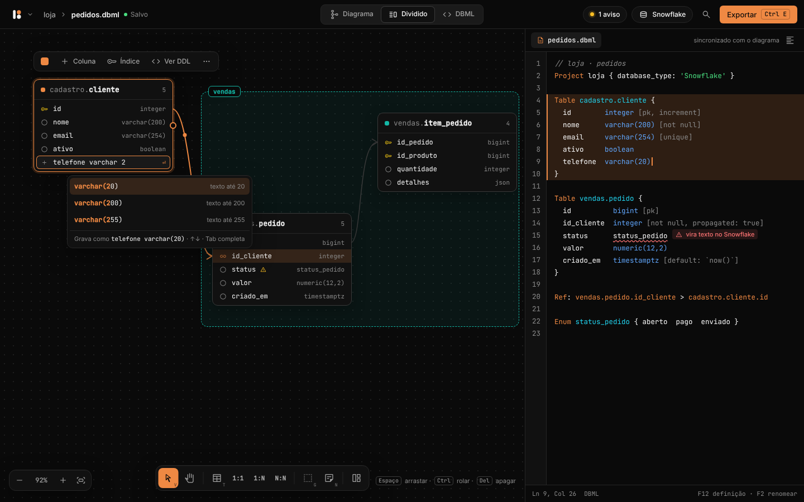
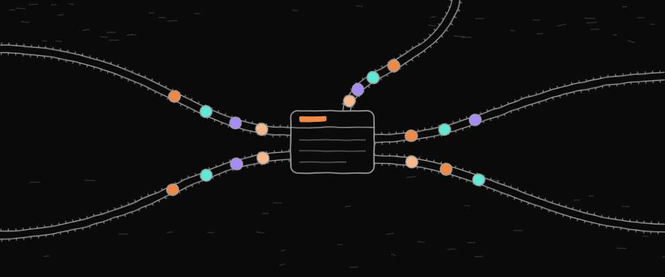
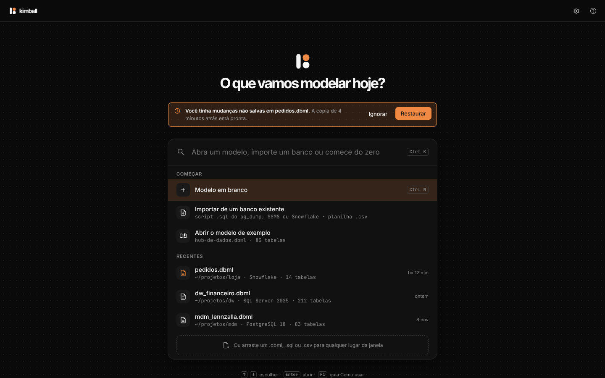
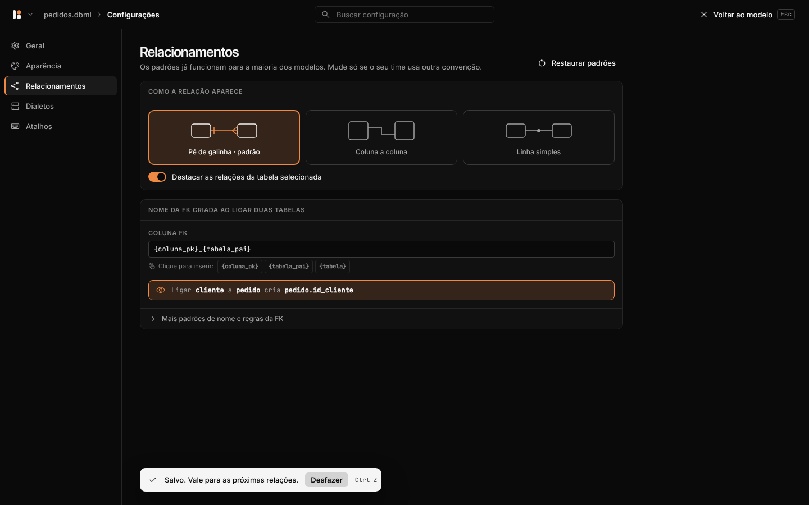
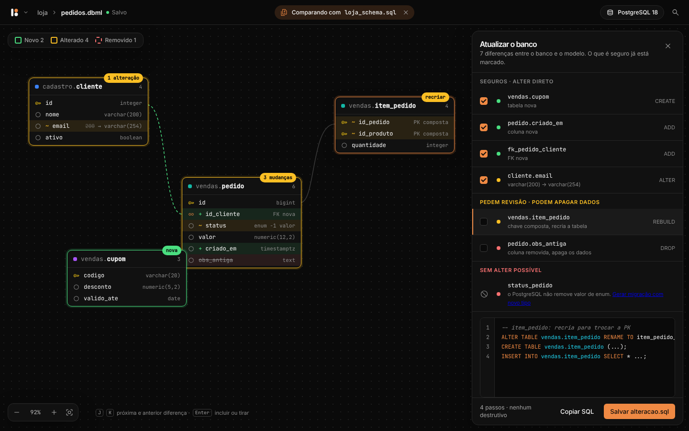

<div align="center">

<picture>
  <source media="(prefers-color-scheme: dark)" srcset="docs/assets/app-icon.svg" />
  <source media="(prefers-color-scheme: light)" srcset="docs/assets/app-icon.svg" />
  
</picture>

# Kimball Modeler

Modelador de bancos de dados multi-dialeto para desktop (Windows, Linux e macOS), com canvas visual, editor DBML, CLI e servidor MCP para agentes de IA.

<p>
  <a href="https://kimball-modeler.pages.dev/"><strong>Site</strong></a> &middot;
  <a href="https://kimball-modeler.pages.dev/docs/"><strong>Documentação</strong></a> &middot;
  <a href="#instalar"><strong>Instalar</strong></a> &middot;
  <a href="#uso-rápido"><strong>Uso rápido</strong></a> &middot;
  <a href="#recursos"><strong>Recursos</strong></a> &middot;
  <a href="#comparação-com-o-banco"><strong>Comparação</strong></a> &middot;
  <a href="#atalhos"><strong>Atalhos</strong></a> &middot;
  <a href="#roadmap"><strong>Roadmap</strong></a> &middot;
  <a href="https://github.com/filipimr/kimball-modeler/releases/latest"><strong>Downloads</strong></a>
</p>

<p>
  <a href="https://github.com/filipimr/kimball-modeler/releases/latest"></a>
  <a href="https://kimball-modeler.pages.dev/docs/"></a>
  
  
  
  
</p>

</div>

<div align="center">
  <picture>
    <source media="(prefers-color-scheme: dark)" srcset="docs/assets/tela-area-de-trabalho.png" />
    <source media="(prefers-color-scheme: light)" srcset="docs/assets/tela-area-de-trabalho-claro.png" />
    
  </picture>
  <p><sub><strong>Modo Dividido (<code>Ctrl 2</code>):</strong> edição de colunas na própria tabela com autocompletar de tipo à esquerda e editor DBML sincronizado à direita.</sub></p>
</div>

## O que faz

Você desenha no canvas ou escreve **DBML**, e os dois ficam sincronizados em tempo real. O texto DBML é a fonte da verdade: cada edição no canvas, na CLI ou via servidor MCP altera apenas o trecho afetado, preservando comentários, ordem e formatação do restante do arquivo. As posições X/Y, cores e viewport ficam em `<arquivo>.layout.json`, ao lado do `.dbml`, para que o diff no Git mostre apenas o que mudou no banco.

O mesmo modelo gera DDL e scripts `ALTER` para **PostgreSQL 12–18**, **SQL Server** (2016, 2017, 2019, 2022 e 2025), **Snowflake**, **MySQL** (8.0, 8.4 e 9.0) e **Oracle** (19c, 21c e 23ai), validados contra as capacidades de cada banco e versão:

- **PostgreSQL:** sequences, domínios, colunas geradas, índices parciais e `INCLUDE`, particionamento;
- **SQL Server:** tipos apelido, colunas computadas, índices filtrados, função e esquema de partição;
- **Snowflake:** clustering (`CLUSTER BY`) e tipos `VARIANT`;
- **MySQL:** `ENUM` na coluna, `AUTO_INCREMENT`, `COMMENT` na linha, `ENGINE`/`CHARSET`/`COLLATE`, colunas geradas e partições `RANGE`/`LIST COLUMNS`;
- **Oracle:** `BOOLEAN`, `JSON` e `IF NOT EXISTS` conforme a versão, identidade, sequences, tabelas `BLOCKCHAIN`/`IMMUTABLE`, `TABLESPACE` e aviso de texto vazio = nulo.

<div align="center">
  <picture>
    <source media="(prefers-color-scheme: dark)" srcset="docs/assets/pipeline-dark.svg" />
    <source media="(prefers-color-scheme: light)" srcset="docs/assets/pipeline-light.svg" />
    
  </picture>
</div>

## Instalar

Baixe o instalador para o seu sistema operacional na página oficial de releases:

👉 **[Baixar última versão (GitHub Releases)](https://github.com/filipimr/kimball-modeler/releases/latest)**

Passo a passo de instalação e atualização, por sistema: [Instalação e atualizações](https://kimball-modeler.pages.dev/docs/instalacao/).

| Sistema | Pacotes | Como instalar |
|---|---|---|
| **Windows** | `.exe` (NSIS), `.msi` | abra o instalador |
| **Linux** | `.AppImage`, `.deb`, `.rpm` | `chmod +x Kimball*.AppImage` e abrir, `sudo apt install ./Kimball*.deb` ou `sudo dnf install ./Kimball*.rpm` |
| **macOS** | `.dmg` | abra e arraste o app para **Aplicativos** |

- O pacote instala também o programa de linha de comando **`kimball`** (CLI + servidor MCP).
- **Atualizações automáticas:** no Windows, macOS e Linux (`.AppImage`), o Kimball verifica novas versões assinadas automaticamente ao abrir e atualiza com um clique. Em `.deb`/`.rpm`, o app avisa quando há nova versão e oferece o link direto da release.
- No Linux, o aplicativo roda em qualquer distribuição com `WebKitGTK 4.1` (Ubuntu 22.04+, Debian 12+, Fedora 38+, Arch Linux e derivados).

## Uso rápido

Comandos principais do aplicativo e do terminal:

- `kimball-app [arquivo.dbml]` abre o aplicativo desktop.
- `kimball validate modelo.dbml [--dialect snowflake]` valida o modelo contra o banco escolhido.
- `kimball export modelo.dbml --dialect sqlserver -o criar.sql` gera o DDL.
- `kimball diff antes.dbml depois.dbml` e `kimball alter banco.sql modelo.dbml` comparam e geram o script de alteração.
- `kimball import script.sql -o modelo.dbml` importa modelos existentes (aceita `.sql`, `.ddl`, `.pdm`, `.xlsx`, `.xls`, `.ods` e `.csv`).
- `kimball mcp modelo.dbml` inicia o servidor MCP; `kimball mcp-config` mostra a configuração pronta para cada IDE.

### Conectar agentes de IA na IDE (MCP e skills)

O binário `kimball` inclui um servidor **MCP** (JSON-RPC 2.0 via stdio) com **39 ferramentas** e **5 skills** embutidas para Claude Code, Cursor, VS Code (GitHub Copilot), Windsurf e Codex. No aplicativo, abra `Ctrl K` → **"Conectar a IA da IDE (MCP)…"** ou execute no terminal:

```bash
kimball mcp-config modelo.dbml
kimball skills install
```

Quando a IA ou o terminal salvam mudanças no `.dbml`, o aplicativo aberto detecta a alteração e atualiza o diagrama automaticamente (com suporte a desfazer com `Ctrl Z`). A CLI e o MCP editam apenas o modelo e nunca executam SQL em banco.

### Modelar pelo terminal e em pipelines de CI

A CLI oferece **mais de 25 subcomandos** que aplicam as mesmas operações estruturadas do canvas:

```bash
# Criar um modelo novo e adicionar tabelas com propagação automática de chave estrangeira
kimball new          vendas.dbml --dialect postgres
kimball add-table    vendas.dbml cadastro.cliente id:bigint:pk:inc "nome:varchar(200):nn"
kimball add-table    vendas.dbml vendas.pedido id:bigint:pk:inc emitido_em:timestamptz:nn
kimball link         vendas.dbml cadastro.cliente vendas.pedido --kind 1:N

# Adicionar domínios, sequences e particionamento declarativo
kimball add-domain   vendas.dbml cadastro.email --type "varchar(254)" --rule "formato=VALUE LIKE '%@%'"
kimball add-sequence vendas.dbml vendas.seq_pedido --start 1000 --owned-by vendas.pedido.id
kimball partition    vendas.dbml vendas.pedido --by "range (emitido_em)" --monthly 2026-01:12 --with-default

# Validar, exportar DDL dividido para migrações, comparar com o banco e gerar dados de teste
kimball validate     vendas.dbml --dialect postgres
kimball ddl          vendas.dbml --split -o migrations/
kimball alter        banco-atual.sql vendas.dbml --preset producao -o alteracao.sql
kimball testdata     vendas.dbml --rows 50 -o seed.sql
```

## Recursos

- **Relacionamentos com propagação automática:** desenhe relações 1:1, 1:N ou N:N arrastando da tabela pai para a filha. O Kimball cria as colunas de FK (`{pk}_{tabela_pai}`), a tabela associativa `many_a_has_many_b`, o índice da FK e as ações padrão `ON DELETE` e `ON UPDATE`. Ao mudar a chave do pai, as colunas dos filhos acompanham automaticamente.
- **Assistente de IA no app** (`Ctrl J`): conecte seu provedor (Anthropic, OpenAI, Google, Ollama local ou servidor compatível com a API da OpenAI); a chave fica no cofre do sistema e só a estrutura do modelo é enviada, nunca dados. Pergunte sobre uma tabela, um problema ou um trecho do DBML; mudanças viram proposta tracejada em laranja e só entram com **Aplicar** (`Ctrl Enter`), desfazível com `Ctrl Z`. Ele age como um **DBA sênior** e, nos provedores com ferramentas, consulta sozinho a validação, as tabelas, o SQL, as capacidades do banco e o diagrama antes de responder.
- **Desempenho em modelos grandes:** projetado para trabalhar com fluidez em modelos com **500+ tabelas**, com auto-layout automático (`Shift L`) e edição instantânea.
- **Editor DBML com LSP próprio:** autocompletar contextual (`Ctrl Espaço`), diagnósticos em tempo real, ir para definição (`F12`), renomear em todo o arquivo (`F2`) e formatador (`Shift Alt F`), disponível no editor embutido e via `kimball lsp`.
- **Validação e correção em um clique:** detecta conflitos de namespace por banco, `UNIQUE` redundante com a PK, `SET NULL` em coluna `NOT NULL` e FKs sem índice, oferecendo **Aplicar correção** com suporte a Desfazer.
- **Domínios, sequences e colunas geradas:** domínios reutilizáveis com regras `VALUE`, sequences vinculadas à coluna (`INC ↔ SEQ` em um clique) e colunas calculadas (`STORED` e `VIRTUAL`) adaptadas a cada dialeto.
- **Particionamento declarativo:** partições `RANGE`, `LIST` ou `HASH` configuradas na tabela-mãe (com gerador mensal e hash), emitindo `PARTITION OF` no PostgreSQL, `PARTITION FUNCTION`/`SCHEME` no SQL Server e `CLUSTER BY` no Snowflake.
- **Código por objeto (`Alt S`):** exibe o SQL da seleção em qualquer banco e versão sem trocar o destino do projeto (só o objeto, com filhos ou com todas as dependências).
- **Análise de dependências e tabelas stub:** a aba **Associações** (e `kimball deps`) lista quem usa cada objeto e do que ele precisa. Tabelas externas podem ser marcadas como **DDL off** (`[ddl: false]`) para servir de referência às FKs sem entrar no script de criação nem no diff.
- **Conexão com PostgreSQL e cofre do sistema:** lê o catálogo com suporte a SSL/TLS, compara o banco ativo com o modelo e executa o script de alteração em uma única transação. As senhas ficam no cofre nativo do sistema operacional (Windows Credential Manager, macOS Keychain ou Linux Secret Service), nunca no arquivo do projeto.
- **Importação e engenharia reversa:** lê bancos PostgreSQL conectados, scripts SQL/DDL (`pg_dump`, SSMS, `GET_DDL` do Snowflake, `mysqldump --no-data`, `DBMS_METADATA.GET_DDL` do Oracle), planilhas Excel e CSV (`.xlsx`, `.xls`, `.ods`, `.csv`) e arquivos de Modelo Físico XML (`.pdm`) preservando as posições do diagrama original.
- **Conversão entre bancos com relatório de perdas:** adapta tipos automaticamente e gera um relatório em Markdown com todas as adaptações antes de trocar o dialeto do projeto.
- **Exportação de DDL, diagramas, dicionário e contratos:**
  - DDL em arquivo único, um arquivo numerado por objeto (`001_schema.sql`, `002_table.sql`...) em ordem topológica, agrupado por tipo, ou script de `DROP` na ordem inversa;
  - diagrama em SVG vetorial (editável no Figma e no Inkscape), PNG e JPG (1×, 2×, 3×), PDF paginado (A4, A3, Carta) e Markdown com diagrama Mermaid;
  - dicionário de dados em HTML, Word (`.rtf`), Excel (`.xlsx` em 3 abas, reimportável) e CSV;
  - contratos em JSON Schema (Draft 2020-12) e XML Schema (XSD), além de dados de teste em SQL ou CSV (`kimball testdata`).
- **Histórico e recuperação:** desfazer e refazer com **500 passos** unificados entre canvas e editor, autosave a cada **10 min** e cópia de recuperação a cada **5 min**.

<div align="center">
  <picture>
    <source media="(prefers-color-scheme: dark)" srcset="docs/assets/tela-inicio.png" />
    <source media="(prefers-color-scheme: light)" srcset="docs/assets/tela-inicio-claro.png" />
    
  </picture>
  <picture>
    <source media="(prefers-color-scheme: dark)" srcset="docs/assets/tela-configuracoes.png" />
    <source media="(prefers-color-scheme: light)" srcset="docs/assets/tela-configuracoes-claro.png" />
    
  </picture>
  <p><sub><strong>À esquerda:</strong> tela inicial (Launcher) com restauração de cópia de recuperação, busca rápida (<code>Ctrl K</code>), importação e modelos recentes. <strong>À direita:</strong> configurações de notação visual, padrões de nome de FK e validação (temas escuro e claro).</sub></p>
</div>

## Comparação com o banco

Ao comparar dois modelos (`kimball diff`) ou comparar o modelo com um script `.sql` / servidor PostgreSQL conectado (`kimball alter` e folha **Atualizar o banco**), o Kimball classifica cada diferença como `Direct`, `Rebuild` ou `Unsupported` e pinta o resultado no canvas (verde para objetos novos, amarelo para alterados ou recriados e vermelho tracejado para removidos).

Os passos destrutivos (`DROP` e `REBUILD`) chegam desmarcados por padrão e exigem revisão explícita do SQL antes de salvar ou executar. Você pode filtrar por objetos novos, removidos ou alterados, ignorar comentários e propriedades físicas, ou aplicar os presets de **desenvolvimento**, **homologação** e **produção**.

<div align="center">
  <picture>
    <source media="(prefers-color-scheme: dark)" srcset="docs/assets/tela-diff-e-alter.png" />
    <source media="(prefers-color-scheme: light)" srcset="docs/assets/tela-diff-e-alter-claro.png" />
    
  </picture>
  <p><sub><strong>Folha Atualizar o banco:</strong> passos diretos (<code>CREATE</code>, <code>ADD</code>, <code>ALTER</code>) vêm marcados; operações que recriam tabelas (<code>REBUILD</code>) ou apagam dados (<code>DROP</code>) ficam desmarcadas até confirmação.</sub></p>
</div>

## Atalhos

| Atalho | O que faz |
| --- | --- |
| `Ctrl 1` / `Ctrl 2` / `Ctrl 3` | ver Diagrama / Dividido (canvas + DBML) / DBML |
| `Ctrl \` | alternar entre Diagrama e Dividido |
| `Ctrl K` | paleta de comandos: buscar tabelas, colunas, relações e rodar ações |
| `T` / `G` / `N` | nova tabela / agrupar a seleção / criar nota |
| `1` / `2` / `3` | desenhar relação 1:1 / 1:N / N:N (arraste da tabela pai para a filha) |
| `Shift + Clique` (com `1`/`2`/`3`) | criar autorrelacionamento (ligar tabela a ela mesma / hierarquia) |
| `V` / `Espaço` (segurar) | selecionar / mover (pan) o canvas |
| `Shift L` / `Shift 1` | organizar o diagrama automaticamente / ajustar à tela |
| `Alt S` | prévia de código da seleção (outro banco, versão, dependências e DBML) |
| `Ctrl E` / `Ctrl Shift E` | abrir folha Exportar (DDL, dicionário, diff...) / exportar o diagrama (SVG, PNG, PDF, Mermaid) |
| `Ctrl N` / `Ctrl O` / `Ctrl S` | modelo em branco / abrir arquivo / salvar `.dbml` + `.layout.json` |
| `Ctrl Z` / `Ctrl Shift Z` (`Ctrl Y`) | desfazer / refazer (histórico unificado de 500 passos) |
| `Del` | apagar a seleção (remove colunas propagadas junto com a relação e mostra Desfazer) |
| `Ctrl + Roda` / `Ctrl =` / `Ctrl -` | zoom de **10% a 500%** (`Ctrl 0` restaura 100%) |
| `F12` / `F2` / `Shift Alt F` | no editor DBML: ir para definição / renomear símbolo em todo o arquivo / formatar |
| `Ctrl J` / `Ctrl M` / `Ctrl Enter` | assistente de IA / trocar o modelo que responde / aplicar a proposta |
| `Ctrl ,` / `F1` / `Esc` | abrir configurações / abrir guia de uso / fechar popover, edição, folha ou comparação |

## Documentação

O manual completo fica em **[kimball-modeler.pages.dev/docs](https://kimball-modeler.pages.dev/docs/)**, também dentro do app na tecla `F1`.

| Página | Conteúdo |
| --- | --- |
| **[Site](https://kimball-modeler.pages.dev/)** | apresentação do Kimball Modeler e downloads |
| **[Primeiros passos](https://kimball-modeler.pages.dev/docs/primeiros-passos/)** | do primeiro modelo ao primeiro script DDL |
| **[Notas de versão](https://kimball-modeler.pages.dev/docs/notas-de-versao/)** | o que mudou em cada versão, com novidades, correções e como atualizar |
| **[Exportar](https://kimball-modeler.pages.dev/docs/guia/exportar/)** | DDL, diagramas, dicionário, JSON Schema, XSD e dados de teste |
| **[Comandos da CLI](https://kimball-modeler.pages.dev/docs/cli/comandos/)** | todos os comandos do terminal e uso em CI |

Problemas e sugestões: [Issues](https://github.com/filipimr/kimball-modeler/issues).

## Roadmap

- ✅ Canvas interativo + Editor DBML bidirecional sem perdas + Servidor LSP
- ✅ Relacionamentos 1:1, 1:N, N:N e autorrelações com propagação automática de FKs e índices
- ✅ Motor multi-dialeto (**PostgreSQL 12–18**, **SQL Server 2016–2025**, **Snowflake**, **MySQL 8.0–9.0**, **Oracle 19c–23ai**) com validador e auto-correção
- ✅ Sequences, Domínios reutilizáveis, Colunas Geradas (`STORED`/`VIRTUAL`), Índices Avançados, Particionamento, Roles e Permissões
- ✅ Prévia de código por objeto/versão (`Alt S`) e exportação DDL para migrações (`--split`, `--drop-script`)
- ✅ Engenharia reversa de scripts SQL/DDL, planilhas Excel/CSV, **Modelo Físico XML (`.pdm`)** e PostgreSQL via SSL
- ✅ Diff visual Modelo × Banco com presets de ambiente, passos destrutivos protegidos e execução transacional
- ✅ Exportação de diagramas (SVG vetorial, PNG, JPG, PDF, Mermaid), Dicionário (HTML, Word `.rtf`, Excel), JSON Schema, XSD e Dados de Teste
- ✅ CLI completa de modelagem/CI, Servidor MCP com **39 ferramentas** e **5 skills** de IA embutidas
- ✅ Atualização automática assinada via GitHub Releases
- ✅ Assistente de IA com o seu provedor (chave no cofre do sistema), propostas revisáveis no canvas
- ✅ Assistente DBA que consulta o modelo com ferramentas antes de responder
- ✅ Claude Code pela sua assinatura, com três níveis de permissão
- 🟡 Assistente: login de conta pelo navegador nos outros provedores
- 🟡 Conectores diretos de catálogo para **SQL Server**, **Snowflake**, **MySQL** e **Oracle**
- 🟡 Novos dialetos: **BigQuery** e **Databricks (Unity Catalog)**
- 🟡 Integração bidirecional com **dbt** e **ODCS v3**
- ⚪ Novos dialetos: **Redshift** e modelagem em camadas (**Conceitual ↔ Lógica ↔ Física**)
